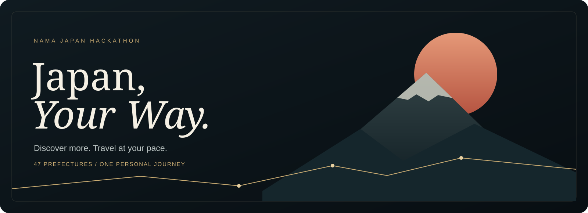
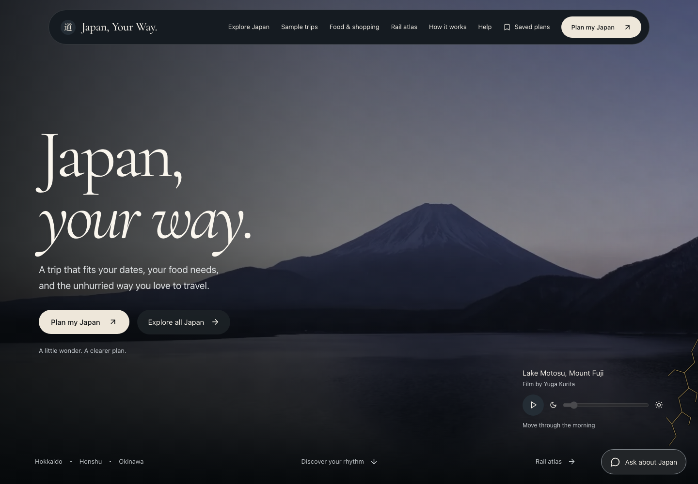
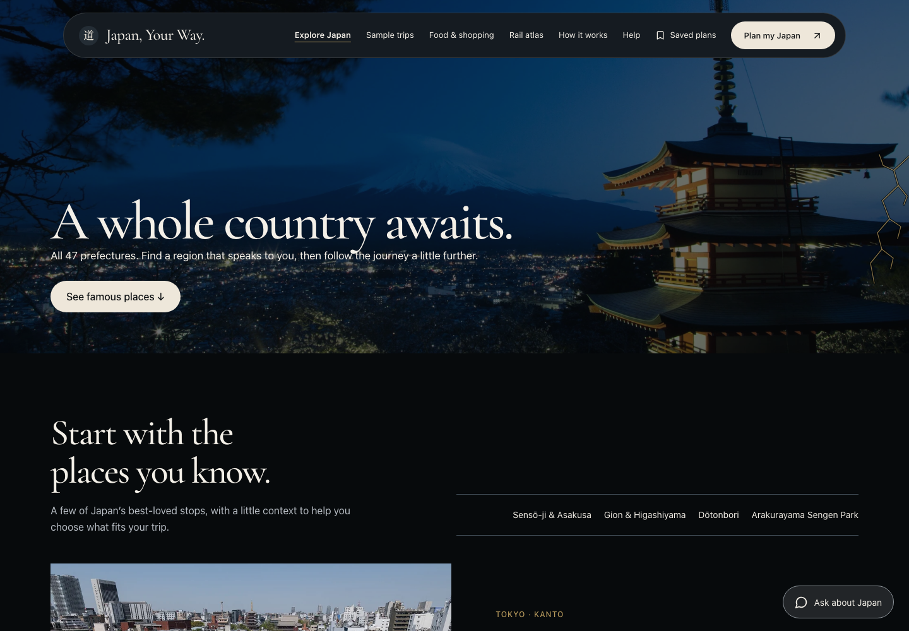
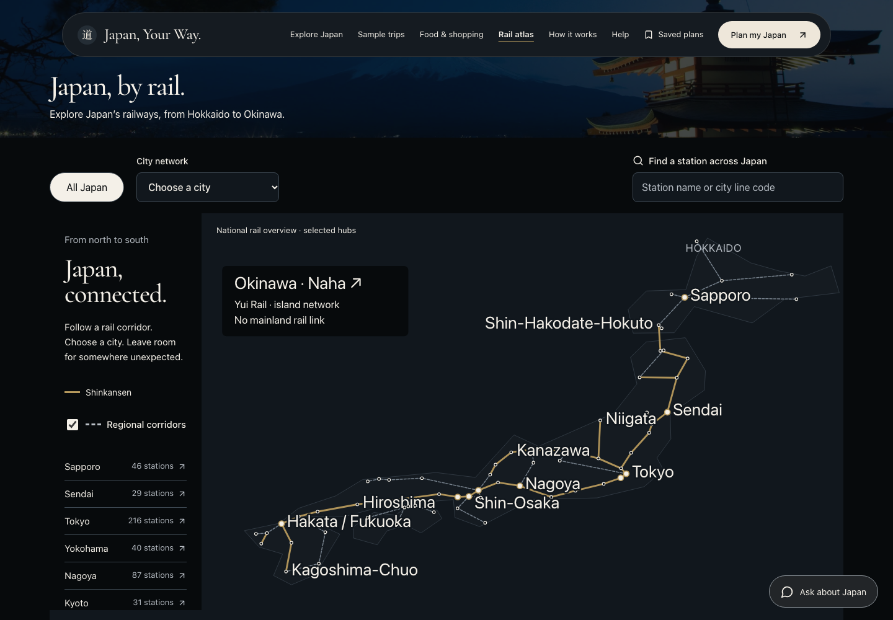
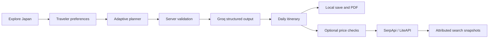

<p align="center">
  
</p>

<p align="center">
  <strong>A personal journey through Japan, shaped around you.</strong><br />
  Explore beyond the familiar. Plan around your pace, your budget, and your food needs.
</p>

<p align="center">
  
  
  
  
  
</p>

<p align="center">
  <a href="#the-experience">The experience</a> &nbsp;·&nbsp;
  <a href="#a-look-inside">A look inside</a> &nbsp;·&nbsp;
  <a href="#run-it-locally">Run locally</a> &nbsp;·&nbsp;
  <a href="#under-the-hood">Architecture</a> &nbsp;·&nbsp;
  <a href="#project-guides">Project guides</a>
</p>

---

<p align="center">
  <strong>47</strong> prefectures &nbsp; / &nbsp;
  <strong>10</strong> tourism regions &nbsp; / &nbsp;
  <strong>639</strong> city-network stations &nbsp; / &nbsp;
  <strong>153</strong> researched restaurants
</p>

## The experience

Japan, Your Way brings destination discovery, an adaptive AI planner, food research, and a rail atlas into one Japan-focused website. Its INR budgets and Indian-market price searches make it especially useful for travelers planning from India.

The journey starts with what you enjoy. Explore a prefecture, choose an interest, and take those preferences into a conversation that builds a day-by-day trip.

| Discover | Shape your trip | Travel prepared |
| :--- | :--- | :--- |
| Explore all 47 prefectures across ten regions. | Answer simple choices that adapt to your previous answers. | Review daily activities, meals, overnight bases, and transit guidance. |
| Find regional ideas around your interests. | Set your pace, companions, budget, food needs, and access requirements. | Compare estimated group allowances with separately sourced price searches. |
| Research food, shopping, and city rail networks. | Refine the conversation and create a revised itinerary. | Save a local copy and download a detailed itinerary PDF. |

### Personalization without a blank prompt

The planner asks one focused question at a time, with three to six choices shaped by what it already knows. You can skip an uncertainty or request different choices. A visible traveler profile keeps the brief understandable, and the Japan travel assistant can use your active itinerary while you browse.

### Food information that shows its evidence

Food discovery distinguishes verified dietary policies, ingredient evidence, and unknowns. Unconfirmed recipes and preparation remain **Needs check**. Restaurant recognition does not become an ingredient guarantee, and unsupported customer ratings are not invented.

### A budget with its assumptions attached

Planning allowances use **INR** and state their group scope. Optional flight and hotel searches show their sources, search details, and check times separately. Missing taxes, unsupported occupancy, and incomplete dates remain visible. Test hotel rates stay labeled as test data.

### Japan beyond the usual route

Interest filters and a prefecture finder connect regional discovery to the planner. The rail atlas adds 639 stations across ten city networks, plus a national overview of 65 selected hubs and 28 corridors. Trace a line, search a station, or follow a linked place into its city map.

## A look inside

Real screenshots from the local website. Layouts and connected results can vary with viewport, configuration, and saved preferences.

<p align="center">
  
</p>

<table>
  <tr>
    <td width="50%"></td>
    <td width="50%"></td>
  </tr>
  <tr>
    <td align="center"><strong>Find your corner of Japan</strong><br />Regional discovery and prefecture guides</td>
    <td align="center"><strong>Understand the connections</strong><br />National overview and city rail networks</td>
  </tr>
</table>

The visual language combines night photography, Cormorant display typography, warm ivory controls, muted gold Kintsugi seams, a Three.js globe, and scroll-linked motion. Native scrolling, reduced-motion preferences, keyboard controls, and readable static content are built into the experience.

## Run it locally

**Requirements:** Node.js 22 or later and npm.

```sh
git clone https://github.com/NAMA-Japan-Hackathon/japan-your-way.git
cd japan-your-way
npm ci
cp .env.example .env.local
npm run dev
```

Open **http://127.0.0.1:3000**. Add your own provider credentials to `.env.local` and restart the server to enable AI or price searches. Discovery and the bundled rail catalogue do not require provider keys.

### Connect the optional services

| Setting | Purpose | Needed for |
| :--- | :--- | :--- |
| `GROQ_API_KEY` | Server-side Groq connection | AI interview, itinerary generation, and chat |
| `GROQ_MODEL` | Structured-output model; defaults to `openai/gpt-oss-120b` | AI model selection |
| `SERPAPI_API_KEY` | Google Flights and Hotels search snapshots | Optional price comparisons |
| `LITEAPI_KEY` | Direct hotel-rate search; sandbox rates are labeled | Optional additional hotel comparisons |
| `APP_ORIGIN` | Canonical public HTTPS origin | Production request checks |
| `TRAVEL_SESSION_SECRET` | A long random secret shared by server instances | Production signed sessions |
| `TRAVEL_HOURLY_LIMIT` | Per-process request allowance; defaults to `160` | Request limits |

**Actual API keys are private configuration.** The repository includes [`.env.example`](.env.example) with empty credential fields; `.env.local`, runtime secrets, authentication files, and local browser data stay outside Git. Set production credentials in the hosting provider's private environment. Never use `NEXT_PUBLIC_` for a secret.

See the [AI setup and provider guide](docs/ai-planner.md) for supported searches, limitations, and deployment configuration.

## Under the hood



| Layer | Technology |
| :--- | :--- |
| Application | Next.js App Router, React, TypeScript |
| Motion and visuals | GSAP, ScrollTrigger, Three.js, locally served fonts and media |
| AI | Groq with strict structured outputs and server-side response validation |
| Search providers | Optional SerpApi and LiteAPI adapters |
| Persistence | Browser storage for conversations and saved trips |
| Hosted runtime | Vinext packaging for Cloudflare Workers |
| Verification | TypeScript, Node tests, Playwright, and axe accessibility checks |

<details>
  <summary><strong>Repository map</strong></summary>

```text
src/
├── app/             Pages, styles, and server API routes
├── components/      Planner, discovery, rail maps, and visual scenes
├── data/            Prefectures, restaurants, shopping, and rail networks
└── lib/             Planning, validation, search adapters, and PDF export
public/
├── images/          Site photography, responsive variants, and credits
├── videos/          Fuji footage, poster, and source metadata
├── fonts/           Local typefaces and their licenses
└── scenes/          Scroll scene runtime
docs/                Product guides, implementation notes, and README visuals
tests/               Domain, API, accessibility, and browser checks
scripts/             Builds, validation, and verification tools
worker/              Cloudflare Worker entry point
```

</details>

### Build and verify

```sh
npm run check              # Types, 51 domain tests, and catalogue validation
npm run build              # Cloudflare Worker build via Vinext
npm run preview:cloudflare # Preview the hosted build
```

For a conventional Next.js server, run `npm run build:next` followed by `npm start`. Server AI routes require a running server or Worker; a static export cannot execute them.

Both build systems generate files under `.next/`. If a type check after switching between them reports missing generated route types, run `npx next typegen`, then repeat `npm run check`.

<details>
  <summary><strong>Additional verification commands</strong></summary>

| Command | Checks |
| :--- | :--- |
| `npm run validate:data` | Sources, dates, image references, and rail/discovery integrity |
| `npm run check:links` | Links, anchors, images, and scripts in an existing static export |
| `npm run check:buttons` | Interactive controls at mobile, tablet, and desktop sizes |
| `npm run test:e2e` | Browser errors, accessibility, and critical user journeys |
| `npm run test:visual` | Screenshots against local visual baselines |
| `npm run test:perf` | Payload, asset, and DOM budgets |
| `npm run test:all` | Combined verification and a generated local report |

</details>

## Scope and trust

| Available today | What to keep in mind |
| :--- | :--- |
| Discovery across 47 prefectures | Restaurant research currently covers Tokyo, Kyoto, and Osaka. |
| AI itineraries and INR budget ranges | Generated suggestions and allowances need real-world confirmation. |
| Optional sourced flight/hotel searches | Search snapshots are not reservations or guaranteed bookable offers. |
| National and city rail atlas | Selected networks and corridors; no live timetables or fare engine. |
| Dietary evidence and allergen information | Unknown ingredients and cross-contact require venue confirmation. |
| Local saves and PDF downloads | Saved IDs work in the same browser; no account sync or collaborative editing. |

The website does not reserve rooms, issue tickets, or take payment. Earlier editable fixture itineraries remain available as samples, including `/plan/?sample=1`; their prices and operating windows are illustrative.

Conversations and saved trips stay in browser storage. Requests send relevant conversation and trip context to Groq; price checks send the required search details to their providers. There is no conversation database or account system. See the [privacy and state explanation](docs/ai-planner.md#privacy-and-state).

## Photography, footage, and credits

The repository includes the site's photographs, responsive image variants, Fuji video and poster, globe texture, and font assets so a checkout retains the visual experience.

Each asset keeps its own rights and attribution. The hero photograph is **“Arakurayama Sengen park morning & evening (cropped)” by tzuyaya, CC BY 2.0**. Further source and license records live in:

- [Image credits](public/images/credits.json) and [hero attribution](public/images/hero-credit.json)
- [Footage source metadata](public/videos/fuji-lake-motosu.source.json)
- [Photo coverage and fallbacks](docs/image-fallbacks.md)
- [Cormorant font license](public/fonts/Cormorant-OFL.txt) and [additional font license](public/fonts/OFL.txt)

Some restaurant and shopping photos retain the existing **unverified — personal use** label. Their inclusion does not grant an open license or establish permission for downstream reuse. Consult each source's rights before republishing those assets. The README banner is an original vector illustration; the screenshots show this application and its credited media.

## Project guides

| Guide | What you will find |
| :--- | :--- |
| [AI planner](docs/ai-planner.md) | Interview flow, providers, configuration, searches, and privacy |
| [Discovery and rail](docs/explore-and-rail.md) | Nationwide coverage, station networks, food data, and limits |
| [Photo inventory](docs/image-fallbacks.md) | Storefront coverage, missing photos, and source records |
| [Product requirements](PRD.md) | Product intent and scope |
| [Design direction](design.md) | Art direction and interaction principles |
| [UI review](UI_REVIEW.md) | Visual decisions, media sources, and motion behavior |
| [Quality notes](QA.md) | Verification history and known limits |
| [GitHub publication](GITHUB_SYNC.md) | Manual publication workflow |

---

<p align="center">
  <strong>Japan, Your Way</strong><br />
  A NAMA Japan Hackathon project<br />
  <em>Start with what moves you. Find the Japan that fits.</em>
</p>
